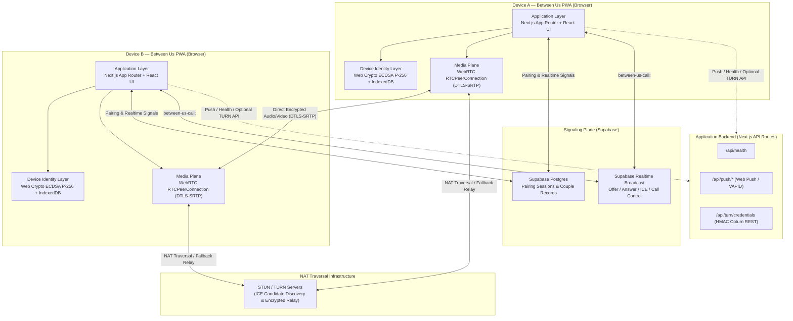

# Between Us

**Between Us** is a private, 1-to-1 audio and video calling Progressive Web Application (PWA) built with Next.js, React, TypeScript, WebRTC, Web Crypto, and Supabase Realtime.

It is designed around a single focused purpose: direct, low-friction voice and video communication between two paired devices, without user accounts, social feeds, messaging threads, call history databases, call recording, or third-party analytics.

---

## Table of Contents

- [Design Philosophy](#design-philosophy)
- [Key Features](#key-features)
- [Technology Stack](#technology-stack)
- [Architecture Overview](#architecture-overview)
- [Application Flow](#application-flow)
- [Repository Structure](#repository-structure)
- [Getting Started](#getting-started)
- [Environment Configuration](#environment-configuration)
- [Supabase Setup](#supabase-setup)
- [Running Locally](#running-locally)
- [Build and Validation](#build-and-validation)
- [Deployment](#deployment)
- [Privacy and Security](#privacy-and-security)
- [Browser Compatibility](#browser-compatibility)
- [Known Limitations](#known-limitations)
- [Roadmap](#roadmap)
- [Contributing](#contributing)
- [Security Reporting](#security-reporting)
- [License](#license)
- [Acknowledgements](#acknowledgements)

---

## Design Philosophy

- **Focused 1-to-1 Scope**: Built strictly for two paired devices—no group rooms, public profiles, chat logs, or discovery directories.
- **Data Minimization**: No call recording code paths, no call history database, and zero analytics or advertising SDKs.
- **Browser-Native Primitives**: Relies directly on WebRTC (`RTCPeerConnection`), the Web Crypto API (`crypto.subtle`), IndexedDB, Service Workers, and the MediaDevices API.
- **Honest Security Posture**: Clearly distinguishes transport-layer WebRTC encryption (`DTLS-SRTP`) from independently verified application-layer end-to-end encryption, and documents architectural limitations transparently.

---

## Key Features

Feature statuses below reflect verified behavior in the current codebase:

| Category | Feature | Status | Implementation Notes |
| :--- | :--- | :--- | :--- |
| **Device Identity** | Non-extractable ECDSA P-256 key generation & SHA-256 fingerprint in IndexedDB | **Implemented** | `lib/crypto/identity/*`, stored in IndexedDB (`between-us-app-db`) with `extractable: false`. |
| **Device Pairing** | 12-character one-time pairing code generation, SHA-256 code hashing, partner approval modal, and local trust persistence | **Implemented** | Active UI uses Supabase Postgres + Realtime (`lib/pairing/supabase-pairing.ts`). A separate cryptographic challenge-response engine (`lib/pairing/service.ts`) exists and is unit-tested, but is not yet wired to the active UI. |
| **Safety Verification** | HKDF-SHA256 Short Authentication String (6 words, 5 emojis, short code, full hex) & match/mismatch controls | **Partially Implemented** | UI modal (`components/between-us/SafetyVerification.tsx`) and HKDF engine (`lib/safety/*`) are implemented, but Supabase pairing does not currently populate the remote partner's SPKI public key, and Settings shows a placeholder code. |
| **Private Home Interface** | Paired partner view, direct Audio/Video call launchers, active call return banner, settings modal | **Implemented** | `app/page.tsx`, `app/home/page.tsx`, `components/between-us/HomeScreen.tsx`. Partner presence indicator is currently static once paired. |
| **Audio Calling** | 1-to-1 WebRTC voice calls with echo cancellation, noise suppression, Opus FEC SDP tuning, mute toggle, and live audio visualizer | **Implemented** | `app/call/audio/page.tsx`, `lib/webrtc/call-manager.ts`, `lib/webrtc/peer-connection.ts`, `components/between-us/AudioVisualizer.tsx`. |
| **Video Calling** | 1-to-1 WebRTC video calls with draggable & swappable Picture-in-Picture (PiP), front/rear camera flip, smart selfie mirroring, and tap-to-hide controls | **Implemented** | `app/call/video/page.tsx`, `components/between-us/CallScreen.tsx`. |
| **Call Management** | Outgoing & incoming call modals, global incoming call listener, simultaneous remote call termination, ICE restart reconnection, back-navigation guard, Screen Wake Lock | **Implemented** | `GlobalIncomingCallHandler.tsx`, `IncomingCallModal.tsx`, `ActiveCallBanner.tsx`, `lib/webrtc/call-state-machine.ts`, `lib/webrtc/call-session-store.ts`, `lib/webrtc/wakelock-manager.ts`. |
| **Ringtones & Haptics** | Outgoing/incoming MP3 ringtones with Web Audio API synthesized fallback and mobile vibration pattern | **Implemented** | `lib/sound/ringtone.ts`, `public/sounds/*.mp3`. |
| **Screen Sharing** | `getDisplayMedia` track replacement with active sharing banner | **Experimental** | Implemented in `lib/webrtc/peer-connection.ts` and `CallScreen.tsx`, but currently blocked by `Permissions-Policy: display-capture=()` in `next.config.ts` and limited to desktop browsers. |
| **Speaker Controls** | Speaker output toggle button in call UI | **Partially Implemented** | Calls `HTMLAudioElement.setSinkId` when supported, without full `enumerateDevices()` audio-output device picker. |
| **Notifications** | Browser Notifications API + Web Push subscription routes (`web-push` / VAPID) | **Partially Implemented** | Foreground browser notifications work when granted. Server-side push subscriptions (`lib/push/push-store.ts`) are stored in volatile process memory (non-persistent across serverless restarts) and require aligning `deviceId` keys between Settings and Call Manager. |
| **Permissions & Hardware Tests** | Microphone & camera permission status checks, live camera preview, and live microphone level meter | **Implemented** | `components/between-us/settings/SettingsScreen.tsx`, `lib/permissions/media-permissions.ts`. |
| **Privacy Controls** | Blur privacy overlay on tab hide, emergency exit cache purge & teardown, sanitized structured logging | **Implemented** | `lib/privacy/privacy-mode.ts`, `lib/privacy/logger.ts`, `components/between-us/PrivacyOverlay.tsx`. |
| **Settings** | Device nickname, pairing status, privacy info, permissions, notifications, security overview, unpair/reset | **Partially Implemented** | Device nickname persistence, hardware tests, ringtone preview, and unpair/reset work; notification preference toggles and manual cache-clear buttons are currently UI-only. |
| **Error & Diagnostics** | Global error boundary + connection diagnostics screen testing internet, signaling, ICE/TURN, and media permissions | **Implemented** | `app/connection-error/page.tsx`, `components/between-us/ErrorBoundary.tsx`, `lib/connection/diagnostics.ts`. |
| **PWA Support** | Web App Manifest, Service Worker static shell cache, update banner, Android/Desktop & iOS install prompts | **Implemented** | `public/manifest.json`, `public/sw.js`, `components/between-us/SWRegister.tsx`, `InstallPrompt.tsx`. |
| **TURN Relay API** | Ephemeral HMAC-SHA1 Coturn REST credential endpoint with rate limiting | **Partially Implemented** | Server endpoint `app/api/turn/credentials/route.ts` and `lib/turn/*` are implemented and tested; runtime WebRTC calls currently use static/public STUN and OpenRelay TURN config in `lib/webrtc/ice.ts`. |
| **Self-Hosted WS Signaling** | Standalone WebSocket signaling server with ECDSA auth, replay protection, and rate limiting | **Experimental / Test-Only** | Implemented and unit-tested under `server/signaling/` and `lib/signaling/client.ts`; not wired to the Next.js runtime UI (which uses Supabase Realtime) and currently lacks a CLI boot entrypoint. |

---

## Technology Stack

Every technology listed below is verified in `package.json` and the current source tree:

- **Frontend**: Next.js 15 (App Router), React 19, TypeScript 5.7 (strict mode), Tailwind CSS v4 (`@tailwindcss/postcss`), `next/font/google` (`Outfit`, `Dancing Script`)
- **Calling & Real-Time Media**: WebRTC (`RTCPeerConnection`, DTLS-SRTP), MediaDevices API, Web Audio API (`AnalyserNode` visualizer & fallback chime synthesis), Screen Wake Lock API, Vibration API
- **Signaling & Backend**: Supabase (`@supabase/supabase-js` — Postgres tables for pairing sessions & Supabase Realtime broadcast channels for WebRTC signaling), Next.js Route Handlers (`app/api/*`), optional WebSocket (`ws`) signaling module (`server/signaling/`)
- **NAT Traversal (ICE)**: STUN/TURN configuration (`lib/webrtc/ice.ts`), server-side HMAC-SHA1 Coturn REST credential generator (`lib/turn/credentials.ts`, Node `crypto`)
- **Cryptography**: W3C Web Crypto API (`crypto.subtle` — non-extractable ECDSA P-256 key pairs, SHA-256 fingerprints, HKDF-SHA256 safety code derivation), pure-JS SHA-256 pairing-code hashing (`lib/crypto/sha256.ts`)
- **Client Storage**: IndexedDB (`between-us-app-db` v3 for keys, partner trust, verification state, app settings), `localStorage` (pairing fallback sync, push toggle flag, PWA install prompt dismissal), Cache Storage (Service Worker app shell)
- **PWA & Push**: Web App Manifest (`public/manifest.json`), Service Worker (`public/sw.js`), Notifications API, `web-push` (VAPID)
- **Security Headers & CI**: Next.js security headers (`next.config.ts` — CSP, HSTS, X-Frame-Options, Referrer-Policy, Permissions-Policy, COOP, CORP), GitHub Actions (CI, CodeQL, Dependency Review, Dependabot)
- **Testing & Tooling**: Node.js built-in test runner (`node:test` + `tsx`), ESLint 9 (`eslint-config-next`), TypeScript (`tsc --noEmit`)

---

## Architecture Overview

Between Us separates **application delivery**, **device identity**, **signaling**, and **peer-to-peer media** across distinct layers. Audio and video streams flow directly between peers via WebRTC (or through a TURN relay when symmetric NATs/firewalls block direct UDP) and never pass through the Next.js server or Supabase.



For a deeper technical breakdown, see [`docs/architecture/README.md`](docs/architecture/README.md).

---

## Application Flow

1. **First Launch (`/`)**: `app/page.tsx` checks IndexedDB for a paired partner record (`loadPairedPartner()`). If unpaired, it redirects to `/pairing`.
2. **Pairing (`/pairing`)**:
   - Device A clicks **Generate Pairing Code**, creating an ECDSA P-256 local identity if needed, generating a 12-character code, storing its SHA-256 hash in `pairing_sessions`, and subscribing for a pairing request.
   - Device B enters the code via **Enter Pairing Code**, submits its device identity, and waits for approval.
   - Device A accepts the request; both devices create/link a shared `coupleId` and persist partner trust in IndexedDB, then navigate to Home.
3. **Safety Verification (In-Call)**: From the in-call options modal, users can open **Safety Code** (`SafetyVerification.tsx`) to view and confirm HKDF-SHA256 verification status. *(See [Known Limitations](#known-limitations) regarding full SPKI binding during Supabase pairing.)*
4. **Home (`/`, `/home`)**: Displays the paired partner card, quick **Audio Call** and **Video Call** buttons, security badge, and access to Settings. `GlobalIncomingCallHandler` runs in the root layout to listen for incoming calls on the shared couple channel.
5. **Audio Calling (`/call/audio`, `/audio`)**: Initializes `AudioCallManager`, acquires microphone media (`video: false`), sends `call_invite`, plays outgoing ringtone, negotiates SDP/ICE over Supabase Realtime, activates Screen Wake Lock, and renders the audio call UI with mute, speaker, options, and audio visualizer.
6. **Video Calling (`/call/video`, `/video`)**: Negotiates audio + video (`facingMode: "user"`), displays full-screen remote video with a draggable/swappable local PiP preview, front/rear camera toggle, and tap-to-hide UI chrome.
7. **Call Termination & Remote Sync**: Ending, declining, or cancelling sends `call_end` / `call_decline` / `call_cancel` over Supabase Realtime, stops all `MediaStreamTrack`s, closes `RTCPeerConnection`, clears timers and Wake Lock, and redirects both peers back to `/home`.
8. **Settings (`/settings`, `/settings/*`)**: Manage device nickname, review pairing & security details, test microphone and camera permissions live, toggle Web Push notifications and preview ringtones, or unpair/reset the device.
9. **Error & Recovery (`/connection-error`, `/error`, `app/error.tsx`)**: Unhandled React errors fall back to `ErrorBoundary` / `ErrorState`. The diagnostics screen probes `/api/health`, Supabase Realtime reachability, ICE/TURN gathering, and browser media permissions.

---

## Repository Structure

```text
BetweenUs/
├── .github/
│   ├── ISSUE_TEMPLATE/         # Bug report, feature request, and security link config
│   ├── workflows/              # CI, CodeQL, Dependency Review, and Security pipelines
│   ├── CODEOWNERS              # Mandatory review ownership for security-sensitive modules
│   ├── SECURITY.md             # GitHub-surfaced security policy
│   └── dependabot.yml          # Automated npm & GitHub Actions dependency updates
├── app/
│   ├── api/
│   │   ├── health/             # GET/HEAD health probe
│   │   ├── push/               # VAPID public key, subscribe, and send endpoints
│   │   └── turn/credentials/   # Rate-limited HMAC-SHA1 Coturn credential API
│   ├── call/{audio,video}/     # Primary audio & video call routes
│   ├── {audio,video}/          # Alias routes for audio & video calls
│   ├── {connection-error,error}/ # Connection diagnostics & error recovery pages
│   ├── home/                   # Home route
│   ├── pairing/                # Device pairing screen
│   ├── pwa-debug/              # Development PWA diagnostics utility page
│   ├── settings/               # Settings page and deep-linked subpages
│   ├── globals.css             # Tailwind v4 styles & custom utilities
│   ├── layout.tsx              # Root layout, fonts, global call & PWA providers
│   ├── manifest.ts             # Dynamic Next.js manifest route
│   └── page.tsx                # Root entry router (paired -> Home, unpaired -> Pairing)
├── components/
│   ├── between-us/             # CallScreen, HomeScreen, incoming call modal, diagnostics, settings
│   └── pairing/                # Pairing modals, header, badges, help dialog
├── docs/
│   ├── architecture/           # System architecture guide, data flows, and ADRs
│   ├── design/                 # PWA & UI/UX design specifications
│   ├── development/            # Foundation notes
│   ├── infrastructure/         # TURN relay specification
│   ├── privacy/                # Data classification, lifecycle, and logging policies
│   ├── protocol/               # Protocol overview
│   ├── release/                # Public release inventory, asset report, license options, readiness report
│   ├── security/               # Public security overview, threat model, and specs
│   └── testing/                # Security test plan
├── lib/
│   ├── connection/             # Live network/signaling/ICE/media diagnostics
│   ├── crypto/                 # Non-extractable ECDSA P-256 device identity & pure-JS SHA-256
│   ├── pairing/                # Supabase pairing flow, partner store, and crypto pairing engine
│   ├── permissions/            # Camera & microphone permission helper
│   ├── privacy/                # Redacting AppLogger and Privacy Mode / Emergency Exit manager
│   ├── push/                   # Web Push client manager, in-memory store, VAPID config
│   ├── safety/                 # HKDF-SHA256 Safety Verification derivation & state machine
│   ├── signaling/              # Supabase Realtime signaling client & WS signaling client
│   ├── sound/                  # Ringtone playback, Web Audio fallback, haptics
│   ├── storage/                # Unified IndexedDB wrapper & payload validation
│   ├── supabase/               # Singleton Supabase client
│   ├── turn/                   # HMAC-SHA1 Coturn credential generator & rate limiter
│   └── webrtc/                 # CallManager, PeerConnection, ICE config, state machine, cleanup, WakeLock
├── public/
│   ├── icons/                  # PWA & browser tab icons
│   ├── images/                 # Runtime background illustrations
│   ├── sounds/                 # Incoming & outgoing ringtone MP3s
│   ├── manifest.json           # Primary Web App Manifest
│   ├── manifest.webmanifest    # Alternate Web App Manifest
│   └── sw.js                   # Service Worker (static shell cache & Web Push handlers)
├── server/
│   └── signaling/              # Optional/test-only standalone WebSocket signaling server
├── tests/                      # Automated Node.js test suite (20 files, 133 tests)
├── .editorconfig
├── .env.example                # Documented placeholder environment template
├── .eslintrc.json
├── .gitignore
├── .nvmrc
├── CODE_OF_CONDUCT.md
├── CONTRIBUTING.md
├── next.config.ts              # Next.js config & HTTP security headers
├── package.json
├── package-lock.json
├── postcss.config.mjs
├── README.md
├── SECURITY.md
└── tsconfig.json
```

---

## Getting Started

### Prerequisites

- **Node.js**: `>=20.0.0` (Node 20 LTS or Node 24 LTS; see `package.json` `engines` and `.nvmrc`)
- **npm**: v10+ (lockfile-based installation via `npm ci`)
- **Git**: For cloning the repository
- **Modern Browser**: Chromium-based browser, Firefox, or Safari with WebRTC, Web Crypto, and IndexedDB support
- **Supabase Project**: Required for live two-device pairing and Realtime call signaling (see [Supabase Setup](#supabase-setup))

### Installation

```bash
git clone https://github.com/KrisCode180402/BetweenUs.git
cd BetweenUs
npm ci
cp .env.example .env.local
```

Edit `.env.local` with your own Supabase project URL and anon key (and optional TURN/VAPID variables).

---

## Environment Configuration

Copy [`.env.example`](.env.example) to `.env.local`. Never commit `.env.local` and never prefix server-only secrets with `NEXT_PUBLIC_`.

| Variable | Scope | Required | Purpose | Where Configured |
| :--- | :--- | :--- | :--- | :--- |
| `NEXT_PUBLIC_SUPABASE_URL` | Public (Client) | **Yes** (for pairing/calling) | Supabase project URL (`https://<ref>.supabase.co`) | `.env.local` / Vercel |
| `NEXT_PUBLIC_SUPABASE_ANON_KEY` | Public (Client) | **Yes** (for pairing/calling) | Supabase project public `anon` key | `.env.local` / Vercel |
| `NEXT_PUBLIC_STUN_SERVER_URL` | Public (Client) | Optional | Primary STUN URI (defaults to Google/Cloudflare/Twilio public STUN list) | `.env.local` / Vercel |
| `NEXT_PUBLIC_SIGNALING_SERVER_URL` | Public (Client) | Optional | WebSocket URL if using the optional self-hosted signaling server (`lib/signaling/client.ts`) | `.env.local` / Vercel |
| `NEXT_PUBLIC_TURN_SERVER_URL` | Public (Client) | Optional | Custom TURN server URI override in `lib/webrtc/ice.ts` | `.env.local` / Vercel |
| `NEXT_PUBLIC_VAPID_PUBLIC_KEY` | Public (Client) | Optional | VAPID public key for Web Push subscriptions (auto-generated ephemerally in dev if unset) | `.env.local` / Vercel |
| `NEXT_PUBLIC_APP_ENV` | Public (Client) | Optional | Environment mode (`development` or `production`) controlling production log suppression | `.env.local` / Vercel |
| `TURN_SHARED_SECRET` | **Server-Only** | Optional | Coturn `static-auth-secret` for HMAC-SHA1 credential generation in `/api/turn/credentials` | `.env.local` / Server Env |
| `TURN_HOST` | **Server-Only** | Optional | Coturn relay hostname (defaults to `turn.betweenus.app`) | `.env.local` / Server Env |
| `TURN_PORT` | **Server-Only** | Optional | Coturn UDP/TCP port (default `3478`) | `.env.local` / Server Env |
| `TURN_TLS_PORT` | **Server-Only** | Optional | Coturn TURNS TLS port (default `5349`) | `.env.local` / Server Env |
| `TURN_CREDENTIAL_TTL_SEC` | **Server-Only** | Optional | Short-lived TURN credential TTL in seconds (default `600`) | `.env.local` / Server Env |
| `VAPID_PRIVATE_KEY` | **Server-Only** | Optional | VAPID private key for signing Web Push requests in `lib/push/vapid.ts` | `.env.local` / Server Env |
| `VAPID_SUBJECT` | **Server-Only** | Optional | `mailto:` or URL contact identifier for Web Push VAPID headers | `.env.local` / Server Env |
| `SIGNALING_PORT` | **Server-Only** | Optional | Port for the optional standalone WS signaling module (`server/signaling/config.ts`, default `8080`) | Server Env |

> **Security Note:** Generate VAPID keys with `npx web-push generate-vapid-keys`. Store `VAPID_PRIVATE_KEY` and `TURN_SHARED_SECRET` strictly in server-side environment variables—never in `NEXT_PUBLIC_*` variables or committed files.

---

## Supabase Setup

The runtime pairing and signaling flows (`lib/pairing/supabase-pairing.ts` and `lib/signaling/supabase-signaling.ts`) interact with **Supabase Postgres** and **Supabase Realtime**.

> **Note:** SQL migration files are not yet committed to the repository. To run your own instance, create a new Supabase project and provision the schema below.

### Required Tables

1. **`device_identities`**:
   - `id` (`text`, primary key — device fingerprint)
   - `name` (`text`)
   - `fingerprint` (`text`)
   - `spki_hex` (`text`)
   - `last_seen_at` (`timestamptz`)
2. **`pairing_sessions`**:
   - `id` (`uuid` or `text`, primary key, default `gen_random_uuid()`)
   - `initiator_device_id` (`text`)
   - `initiator_device_name` (`text`)
   - `pairing_code_hash` (`text` — SHA-256 hash of pairing code)
   - `status` (`text` — `pending`, `requested`, `accepted`, `rejected`, `expired`)
   - `expires_at` (`timestamptz`)
   - `target_device_id` (`text`, nullable)
   - `target_device_name` (`text`, nullable)
   - `couple_id` (`uuid` or `text`, nullable)
   - `used_at` (`timestamptz`, nullable)
   - `created_at` (`timestamptz`, default `now()`)
3. **`couples`**:
   - `id` (`uuid` or `text`, primary key, default `gen_random_uuid()`)
   - `created_at` (`timestamptz`, default `now()`)
4. **`couple_members`**:
   - `couple_id` (`uuid` or `text`, references `couples(id)`)
   - `device_id` (`text`)
   - `device_name` (`text`)

### Realtime & Row Level Security (RLS)

- **Enable Supabase Realtime** on `pairing_sessions` (for `postgres_changes` `UPDATE` events) and ensure Realtime Broadcast channels are enabled (`pairing:*`, `pairing_resp:*`, `between-us-call:*`).
- **Enable Row Level Security (RLS)** on every table above. Do **not** disable RLS or grant unrestricted public read/write policies in production. Because the current client operates without Supabase Auth user sessions (`persistSession: false`), design scoped RLS policies or move pairing session mutations behind authenticated Edge Functions / Next.js Route Handlers before exposing a multi-user deployment.
- Configure `NEXT_PUBLIC_SUPABASE_URL` and `NEXT_PUBLIC_SUPABASE_ANON_KEY` in `.env.local` (and in your hosting provider's environment settings).

---

## Running Locally

```bash
npm run dev
```

Open `http://localhost:3000`.

### Media & PWA Testing Notes

- **HTTPS Requirement**: Browsers allow `getUserMedia` (microphone/camera) and `crypto.subtle` on `http://localhost`, but **require HTTPS** when testing from another device (such as a phone on your LAN). Use an HTTPS reverse proxy, tunnel, or preview deployment (e.g., Vercel) when testing two-device mobile calling.
- **Service Worker in Development**: `components/between-us/SWRegister.tsx` automatically unregisters Service Workers and clears Cache Storage on `localhost` / `development` to avoid stale dev bundles. Test PWA installation and offline caching against a production build (`npm run build && npm run start` over HTTPS).

---

## Build and Validation

All verified scripts from `package.json`:

```bash
# Deterministic dependency install
npm ci

# TypeScript strict type check
npm run type-check

# ESLint check
npm run lint

# Automated test suite (Node.js test runner via tsx — 20 test files, 133 tests)
npm test

# Production Next.js build
npm run build

# Start built production server
npm run start

# High/critical dependency vulnerability audit
npm audit --audit-level=high
```

---

## Deployment

Between Us is a standard Next.js 15 App Router application compatible with **Vercel** (or any Node.js >=20 host supporting Next.js Route Handlers):

1. Import the repository into Vercel (or your Node.js hosting provider).
2. Configure the required environment variables (`NEXT_PUBLIC_SUPABASE_URL`, `NEXT_PUBLIC_SUPABASE_ANON_KEY`, plus optional `TURN_*` and `VAPID_*` server variables) in the project's hosting dashboard.
3. Build command: `npm run build` | Install command: `npm ci`.
4. Verify HTTP security headers (`next.config.ts`) and `/api/health` after deployment.
5. Note on serverless deployments: `lib/push/push-store.ts` currently stores Web Push subscriptions in memory, which does not persist across cold starts or multiple serverless instances.

---

## Privacy and Security

For the full public security overview, see [`docs/security/SECURITY_OVERVIEW.md`](docs/security/SECURITY_OVERVIEW.md).

### What Between Us Is Designed to Protect

- **Media Confidentiality in Transit**: WebRTC requires `DTLS-SRTP` encryption for all peer-to-peer audio and video streams. Neither the Next.js server, Supabase Realtime, nor a TURN relay receives DTLS-SRTP media decryption keys.
- **Transport Encryption vs. Independently Verified App-Level E2EE**: WebRTC's built-in DTLS-SRTP provides encrypted transport between peer endpoints, assuming signaling integrity. Full independently verified application-level end-to-end encryption (binding out-of-band verified device keys to DTLS fingerprints during live Supabase signaling) is **not yet completed**—see [Known Limitations](#known-limitations).
- **Local Key Storage**: Device ECDSA P-256 private keys are generated via the Web Crypto API with `extractable: false` and persisted in browser IndexedDB (`between-us-app-db`).
- **HTTP Security Headers**: `next.config.ts` sets `Content-Security-Policy`, `Strict-Transport-Security`, `X-Frame-Options: DENY`, `X-Content-Type-Options: nosniff`, `Referrer-Policy: no-referrer`, `Permissions-Policy`, `Cross-Origin-Opener-Policy`, and `Cross-Origin-Resource-Policy`.
- **Log Sanitization**: `lib/privacy/logger.ts` suppresses `info`/`debug` output in production and redacts private keys, SDP payloads, ICE candidates, and token fields.
- **Service Worker Isolation**: `public/sw.js` caches only static shell assets and explicitly bypasses `/api/`, `ws:`/`wss:`, `supabase`, and `turn` traffic.

---

## Browser Compatibility

| Capability | Desktop Chrome / Edge | Desktop Firefox | Desktop Safari | Android Chrome (PWA) | iOS Safari (PWA) |
| :--- | :--- | :--- | :--- | :--- | :--- |
| **Audio & Video Calling (WebRTC)** | Supported | Supported | Supported | Supported | Supported (iOS 15+) |
| **Front / Rear Camera Flip** | Supported (if multi-cam) | Supported (if multi-cam) | Supported (if multi-cam) | Supported | Supported |
| **PWA Installation** | `beforeinstallprompt` | Limited (tab/shortcut) | Dock / Add to Dock | `beforeinstallprompt` | Manual Share → Add to Home Screen |
| **Notifications / Web Push** | Supported | Supported | Supported | Supported | Requires installed Home Screen PWA (iOS 16.4+) |
| **Screen Sharing (`getDisplayMedia`)** | Blocked by current `Permissions-Policy: display-capture=()` | Blocked by current `Permissions-Policy` | Blocked by current `Permissions-Policy` | Not supported on mobile browsers | Not supported on iOS |
| **System Audio in Screen Share** | Chromium tab/system audio only (when policy allows) | Limited | Not supported | Not supported | Not supported |
| **Speaker Output Switching (`setSinkId`)** | API supported (needs device picker) | Limited / behind pref | Not supported | Not supported (OS controls routing) | Not supported (OS controls routing) |
| **Screen Wake Lock** | Supported | Supported (modern versions) | Supported (16.4+) | Supported | Supported (16.4+) |

---

## Known Limitations

- **Supabase Pairing & Cryptographic Verification Gap**: Live pairing uses Supabase Postgres + Realtime (`lib/pairing/supabase-pairing.ts`) without yet wiring the ECDSA challenge-response flow (`lib/pairing/service.ts`) or storing the partner's SPKI public key—which prevents live Safety Verification (`SafetyVerification.tsx`) from computing a dual-identity HKDF digest on Supabase-paired devices.
- **Signaling Channel Authentication**: Supabase Realtime broadcast messages on `between-us-call:<coupleId>` validate timestamps, message size, and replay IDs, but rely on `coupleId` secrecy rather than per-message cryptographic signatures.
- **No Committed SQL Migrations**: Supabase table schemas and RLS policies must currently be created manually in your Supabase project.
- **Public Fallback TURN Relay**: `lib/webrtc/ice.ts` includes public OpenRelay TURN fallback servers (`openrelay.metered.ca`) for NAT traversal. The HMAC-SHA1 Coturn credential API (`/api/turn/credentials`) is implemented and tested but not yet wired into `AudioCallManager`.
- **Volatile Push Subscription Store**: `lib/push/push-store.ts` keeps Web Push subscriptions in an in-memory `Map`, and Settings currently registers push subscriptions using device nickname while `AudioCallManager` targets partner fingerprint.
- **Screen Sharing Policy Restriction**: `next.config.ts` enforces `Permissions-Policy: display-capture=()`, which disables `getDisplayMedia` until updated to `display-capture=(self)`.
- **Incomplete UI Controls**: Settings notification toggle switches, manual cache-clear buttons, and the pairing page `LanguageSelector` are currently UI-only placeholders; `HomeScreen` does not yet query live partner online presence.
- **Competing Manifest Definitions**: `public/manifest.json`, `public/manifest.webmanifest`, and `app/manifest.ts` currently coexist with minor theme-color/description differences (`app/layout.tsx` links `/manifest.json`).
- **Debug Route Present**: `/pwa-debug` is currently accessible as an unauthenticated diagnostic route.

---

## Roadmap

Planned engineering work based on the verified gaps above:

- [ ] Add versioned Supabase SQL migrations and strict Row Level Security (RLS) policies.
- [ ] Persist remote partner SPKI public keys during pairing and wire mutual ECDSA authentication + live HKDF-SHA256 Safety Verification across Settings and active calls.
- [ ] Wire `fetchTurnCredentials()` (`/api/turn/credentials`) into `AudioCallManager` for authenticated ephemeral Coturn relay sessions.
- [ ] Persist Web Push subscriptions cleanly and align `deviceId` identifiers across Settings and `AudioCallManager`.
- [ ] Consolidate PWA manifest definitions to a single source of truth and gate `/pwa-debug` to development mode only.
- [ ] Implement real persistence for Settings notification toggles and `enumerateDevices()` speaker selection where supported.
- [ ] Resolve upstream `next` / transitive security advisories reported by `npm audit`.

---

## Contributing

Contributions are welcome once you have reviewed [`CONTRIBUTING.md`](CONTRIBUTING.md) and [`CODE_OF_CONDUCT.md`](CODE_OF_CONDUCT.md). Please run `npm run type-check`, `npm run lint`, `npm test`, and `npm run build` before submitting a pull request.

---

## Security Reporting

Please do **not** report security vulnerabilities in public GitHub issues. Follow the responsible disclosure process in [`SECURITY.md`](SECURITY.md).

---

## License

**No open-source license has been selected yet** (default copyright / All Rights Reserved currently applies).

A license decision is pending repository owner approval—see [`docs/release/LICENSE_OPTIONS.md`](docs/release/LICENSE_OPTIONS.md). Until a `LICENSE` file is added by the repository owner, no redistribution or commercial reuse rights are granted.

---

## Acknowledgements

Between Us is built with open-source software including [Next.js](https://nextjs.org/), [React](https://react.dev/), [Tailwind CSS](https://tailwindcss.com/), [Supabase JS](https://github.com/supabase/supabase-js), [web-push](https://github.com/web-push-libs/web-push), [ws](https://github.com/websockets/ws), and Google Fonts (`Outfit`, `Dancing Script`).
