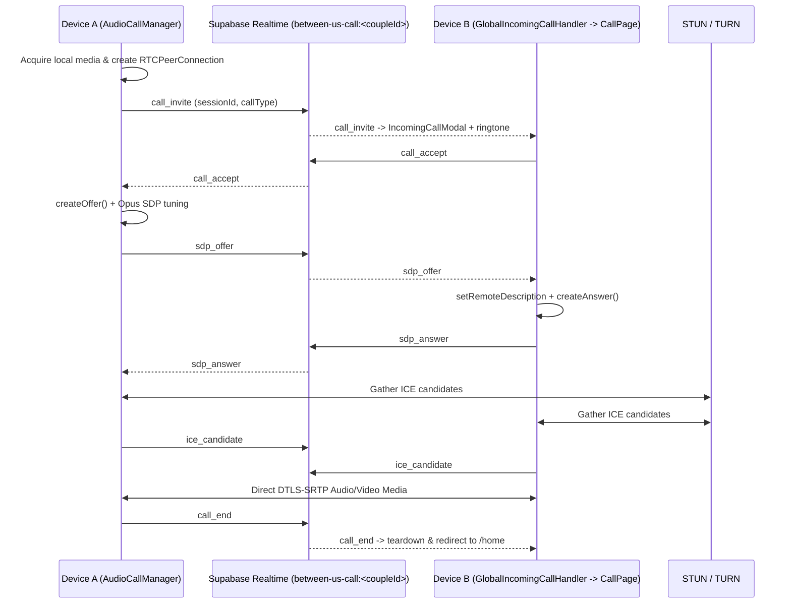

# Architecture Guide — Between Us

This guide documents the **actual verified architecture** of Between Us as implemented in the repository today, alongside pointers to historical design specifications and Architecture Decision Records (ADRs).

> **Architecture Evolution Note:** Early V1 specifications and ADRs in this folder (`ADR-001` through `ADR-010`) were authored before Supabase Realtime was introduced for pairing and call signaling. Where the codebase evolved beyond early V1 plans, this document reflects the **actual current implementation**.

---

## 1. System Layers

Between Us is structured into five clear layers:

1. **Application Layer (`app/`, `components/`)**:
   - Next.js 15 App Router + React 19 client components.
   - Root layout (`app/layout.tsx`) mounts global providers: `ErrorBoundary`, `GlobalIncomingCallHandler`, `ActiveCallBanner`, `InstallPrompt`, and `SWRegister`.
   - Call routes (`/call/audio`, `/call/video`, plus `/audio`, `/video` aliases) share `CallScreen` and `callSessionStore` so active call state survives navigation to `/home` via the minimized banner.
2. **Device Identity & Local Storage Layer (`lib/crypto/`, `lib/storage/`)**:
   - Generates a non-extractable **ECDSA P-256** key pair via `window.crypto.subtle.generateKey(..., false, ["sign", "verify"])`.
   - Computes a SHA-256 hex fingerprint of the exported SPKI public key.
   - Persists keys, partner trust, safety verification records, and app settings inside unified IndexedDB database `between-us-app-db` (version 3) with four object stores (`keys`, `partner_trust`, `partner_verification`, `app_state`) and a 1200ms timeout + in-memory fallback (`lib/storage/db.ts`).
3. **Signaling & Pairing Plane (`lib/pairing/`, `lib/signaling/`, `lib/supabase/`)**:
   - **Active Runtime Implementation**:
     - `lib/pairing/supabase-pairing.ts` uses Supabase Postgres (`device_identities`, `pairing_sessions`, `couples`, `couple_members`) plus Supabase Realtime channels (`pairing:<sessionId>`, `pairing_resp:<sessionId>`) and same-origin `localStorage`/`BroadcastChannel` fallbacks to pair two devices via a 12-character code hashed with pure-JS SHA-256.
     - `lib/signaling/supabase-signaling.ts` creates an ephemeral Supabase Realtime broadcast channel (`between-us-call:<coupleId>`) carrying `call_invite`, `call_accept`, `call_decline`, `call_cancel`, `sdp_offer`, `sdp_answer`, `ice_candidate`, and `call_end` payloads with size limits (64 KB), timestamp drift checks (10 min), and replay deduplication.
   - **Unit-Tested / Optional Self-Hosted Modules**:
     - `lib/pairing/service.ts` implements an ECDSA-signed mutual challenge-response pairing state machine (unit-tested, not wired to the UI).
     - `lib/signaling/client.ts` and `server/signaling/*` implement a standalone WebSocket signaling client/server with ECDSA `SESSION_JOIN` authentication, nonce replay protection, and per-IP/per-socket rate limiting (unit-tested, not wired to the UI).
4. **Media Plane (`lib/webrtc/`)**:
   - `AudioCallManager` (`lib/webrtc/call-manager.ts`) orchestrates both audio and video call lifecycles using `CallStateMachine` (`lib/webrtc/call-state-machine.ts`), `PeerConnectionManager` (`lib/webrtc/peer-connection.ts`), `ringtoneManager`, `wakeLockManager`, and `cleanupCallSession()`.
   - `PeerConnectionManager` manages `RTCPeerConnection`, Opus FEC SDP tuning (`useinbandfec=1;maxaveragebitrate=64000`), adaptive bitrate encoding limits, camera flipping (`switchCamera()`), screen share track replacement (`getDisplayMedia`), and ICE restarts.
   - `lib/webrtc/ice.ts` builds `RTCConfiguration` (`bundlePolicy: "max-bundle"`, `rtcpMuxPolicy: "require"`) with global STUN servers, optional env-configured TURN, and public OpenRelay fallback.
5. **Backend API & PWA Infrastructure (`app/api/`, `lib/turn/`, `lib/push/`, `public/sw.js`)**:
   - `/api/health`: Liveness probe used by `lib/connection/diagnostics.ts`.
   - `/api/turn/credentials`: Rate-limited (`lib/turn/rate-limiter.ts`) HMAC-SHA1 Coturn REST credential generator (`lib/turn/credentials.ts`). Implemented and tested; not yet wired into `AudioCallManager`.
   - `/api/push/*`: VAPID public-key retrieval, subscription registration, and Web Push dispatch via `web-push` (`lib/push/*`). Subscriptions are currently stored in volatile process memory.
   - `public/sw.js`: Static app shell cache (`between-us-static-v1`) that explicitly bypasses `/api/`, `ws:`/`wss:`, `supabase`, and `turn` URLs, and handles incoming Web Push notification display and click actions.

---

## 2. Call Lifecycle Sequence

---

## 3. Additional Architecture Documents

The following historical design specifications and ADRs are preserved for engineering context:

- [`architecture-overview.md`](architecture-overview.md) — Original V1 conceptual overview
- [`call-state-machine.md`](call-state-machine.md) — Call state transition specification
- [`data-flow.md`](data-flow.md) — Signaling & media data-flow diagrams
- [`network-architecture.md`](network-architecture.md) — NAT traversal & network topology
- [`secrets-architecture.md`](secrets-architecture.md) — Environment secret isolation boundaries
- [`security-failure-model.md`](security-failure-model.md) — Fail-closed design principles
- [`storage-architecture.md`](storage-architecture.md) — Client storage architecture
- [`trust-boundaries.md`](trust-boundaries.md) — Trust boundary definitions
- [`architecture-decisions/`](architecture-decisions/) — `ADR-001` through `ADR-010`
