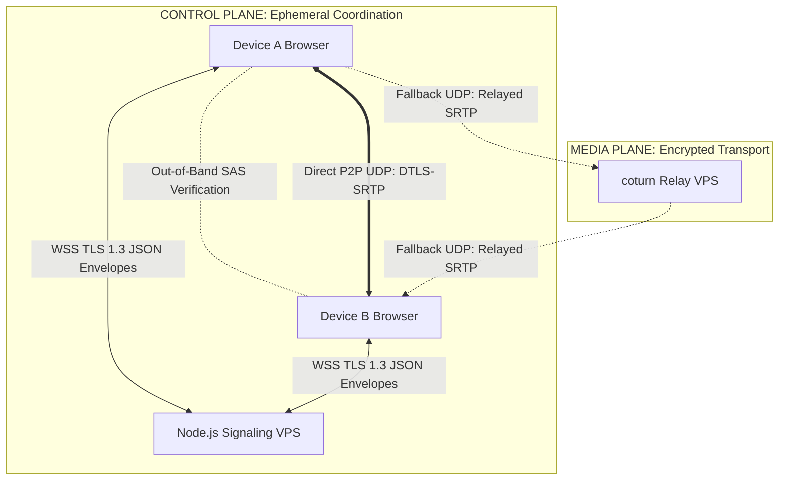

# Architecture Overview — Between Us

**Tagline**: Two People. One Private Connection.  
**System Phase**: Phase 02 — Final System & Trust Architecture  
**Status**: Approved Architecture Blueprint  

---

## 1. Executive Conceptual Architecture

**Between Us** is a privacy-first, 1-to-1 WebRTC Progressive Web Application (PWA). The system separates operational responsibilities into two strictly isolated planes: the **Control Plane** (out-of-band pairing, signaling, SDP offer/answer exchange, ICE candidate negotiation) and the **Media Plane** (encrypted real-time WebRTC audio/video transport).

```
                                    BETWEEN US
                                         |
                                ┌────────▼────────┐
                                │   USER DEVICE   │
                                │                 │
                                │ Browser / PWA   │
                                │                 │
                                │ Web Crypto      │
                                │ IndexedDB       │
                                │ WebRTC          │
                                └───────┬─────────┘
                                        |
                ┌───────────────────────┼───────────────────────┐
                │                       │                       │
                ▼                       ▼                       ▼
           Cloudflare               Signaling                 TURN
             Edge                    Server                  Server
               │                    (Node.js)               (coturn)
               ▼                        │                       │
             Vercel                     │                       │
            Frontend                    │                       │
                                        ▼                       ▼
                                  Partner Device          Partner Device
```

---

## 2. Plane Separation: Control Plane vs. Media Plane

### 2.1 Control Plane Architecture
* **Purpose**: Coordinates connection establishment, peer authentication, SDP negotiation, and network path discovery without handling live media.
* **Components**:
  * Out-of-band ephemeral pairing transport.
  * Node.js WebSocket signaling server (`wss://signaling.betweenus.app`).
  * Cryptographic identity signatures and Short Authentication String (SAS) verification.
  * SDP Offer / Answer exchange.
  * Trickle ICE candidate routing.
* **Trust Level**: **Untrusted for Call Content**. The signaling server facilitates JSON envelope delivery but possesses zero media decryption keys.

### 2.2 Media Plane Architecture
* **Purpose**: Transmits encrypted audio and video payloads between peer browser endpoints in real time.
* **Components**:
  * WebRTC `RTCPeerConnection` engines.
  * Mandatory DTLS 1.2/1.3 mutual handshake.
  * SRTP (AES-GCM / AES-CTR) encrypted media streams (Opus audio, VP8/AV1 video).
  * Direct socket P2P UDP connections (Primary).
  * Encrypted coturn TURN UDP packet relaying (Fallback when P2P is blocked by NAT).
* **Trust Level**: **End-to-End Encrypted**. Media is decrypted strictly inside client browser process memory. Intermediary relays (coturn) cannot inspect or modify decoded media.



---

## 3. Frontend Application Architecture (Next.js / React)

The frontend codebase is organized with a strict separation of concerns, ensuring that cryptographic state, session coordination, and WebRTC drivers are decoupled from visual components.

### 3.1 Proposed Conceptual File Structure

```
app/                        # Next.js App Router UI pages & layouts
  layout.tsx                # App root layout with security headers & meta
  page.tsx                  # Main single-screen calling PWA interface
components/                 # React UI components
  call/                     # Call control buttons, video surface, SAS display
  pairing/                  # Ephemeral pairing modal & code entry UI
  security/                 # Verification banners & security warnings
lib/                        # Isolated functional modules
  crypto/                   # Web Crypto API wrappers (Ed25519, X25519, HKDF)
  pairing/                  # Pairing state machine & SAS code generator
  signaling/                # WebSocket client, auto-reconnect, schema validators
  webrtc/                   # PeerConnection manager, DTLS listener, track control
  storage/                  # IndexedDB non-extractable key store & partner store
  security/                 # CSP checkers, frame blockers, sanitized loggers
  privacy/                  # Zero-retention garbage collection utilities
  session/                  # Ephemeral call lifecycle state machine
```

### 3.2 Component Module Communication Matrix

```
[ React UI Components ]
         │ (Events: Click "Call", Submit "Pairing Code")
         ▼
[ Session Manager (lib/session) ]
         │
         ├─► Reads/Writes ──► [ Local Storage (lib/storage) ] (Identity Public Keys)
         │
         ├─► Invokes ───────► [ Crypto Module (lib/crypto) ] (Sign SDP, Compute SAS)
         │
         ├─► Controls ──────► [ Signaling Client (lib/signaling) ] (Send/Receive WSS)
         │
         └─► Manages ───────► [ WebRTC Engine (lib/webrtc) ] (Media Tracks, PeerConnection)
```

---

## 4. End-to-End System Integration Flow

```mermaid
sequenceDiagram
    autonumber
    actor Alice as Device A (PWA)
    participant Sig as Signaling VPS
    participant TURN as coturn VPS
    actor Bob as Device B (PWA)

    Note over Alice, Bob: Control Plane: Out-of-Band Pairing & Verification
    Alice->>Sig: PAIRING_REQUEST (WSS)
    Sig-->>Alice: Pairing Code Token (TTL 3m)
    Alice-->>Bob: Verbal / Out-of-Band Share of Code
    Bob->>Sig: PAIRING_SUBMIT (Code + PubKey_B)
    Sig->>Alice: Forward PubKey_B + Challenge
    Alice->>Sig: Submit Signed PubKey_A
    Sig->>Bob: Forward Signed PubKey_A
    Note over Alice, Bob: HKDF-SHA256 SAS Visual Verification

    Note over Alice, Bob: Control Plane: SDP & ICE Candidate Negotiation
    Alice->>Sig: SDP_OFFER (Signed)
    Sig->>Bob: Forward SDP_OFFER
    Bob->>Sig: SDP_ANSWER (Signed)
    Sig->>Alice: Forward SDP_ANSWER
    Alice->>Sig: ICE_CANDIDATE (Trickle)
    Bob->>Sig: ICE_CANDIDATE (Trickle)

    Note over Alice, Bob: Media Plane: DTLS-SRTP Session Setup
    alt Direct P2P Available
        Alice<->Bob: DTLS 1.3 Handshake & SRTP Audio/Video Stream
    else NAT Blocked
        Alice->>TURN: Relayed SRTP Packets (UDP)
        TURN->>Bob: Relayed SRTP Packets (UDP)
    end

    Note over Alice, Bob: Control Plane & Media Plane Teardown
    Alice->>Sig: DISCONNECT (Or Close Socket)
    Alice->>Alice: Stop Media Tracks + Purge Ephemeral RAM Keys
    Bob->>Bob: Stop Media Tracks + Purge Ephemeral RAM Keys
```

---

## 5. Privacy Mode & Emergency Exit Teardown Architecture

Under Phase 22 (`BETWEEN_US_PRIVACY_MODE_V1`), the application incorporates an authoritative Privacy Mode state machine:

```text
NORMAL  →  PRIVACY_MODE_ACTIVE  →  EMERGENCY_EXITING  →  SAFE_HOME
```

1. **Privacy Mode Activation**: Visual privacy screen (`PrivacyOverlay`) obscures local/remote video previews, partner identity, and controls when requested or when tab is backgrounded (`visibilitychange`).
2. **Emergency Exit Teardown**: Invoking `activateEmergencyExit()` executes Phase 21 `cleanupCallSession()` to halt hardware tracks, close WebRTC sockets, invalidate session IDs, and reset state machine.
3. **Safe Home Return**: Application transitions immediately to `SAFE_HOME` state without persisting any session remnants, call logs, or activity markers.
