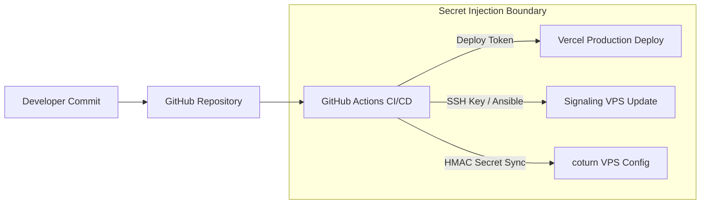

# Deployment Architecture — Between Us

**Tagline**: Two People. One Private Connection.  
**System Phase**: Phase 02 — Final System & Trust Architecture  
**Status**: Approved Specification  

---

## 1. Production Deployment Topology

```
+-----------------------------------------------------------------------------------+
|                                PRODUCTION DEPLOYMENT                              |
|                                                                                   |
|  +-----------------------------------------------------------------------------+  |
|  | CLOUDFLARE SECURITY PERIMETER                                               |  |
|  | - DNS Management (betweenus.app, signaling.betweenus.app, turn.betweenus.app) |  |
|  | - DDoS Protection & Web Application Firewall (WAF)                          |  |
|  | - Strict HSTS Preload (max-age=63072000) & Automatic SSL/TLS 1.3              |  |
|  +---------------------------------------┬-------------------------------------+  |
|                                          │                                        |
|              ┌───────────────────────────┼───────────────────────────┐            |
|              │                           │                           │            |
|              ▼                           ▼                           ▼            |
|  +-----------------------+   +-----------------------+   +---------------------+  |
|  | VERCEL EDGE RUNTIME   |   | HARDENED SIGNALING    |   | HARDENED TURN       |  |
|  | - Frontend PWA Host   |   |   VPS (Ubuntu/Debian) |   |   VPS (Ubuntu/Deb)  |  |
|  | - Static Next.js App  |   | - Node.js TypeScript  |   | - coturn Daemon     |  |
|  | - Service Worker      |   | - Systemd Isolation   |   | - Static Relay      |  |
|  +-----------------------+   +-----------------------+   +---------------------+  |
+-----------------------------------------------------------------------------------+
```

---

## 2. Platform Component Responsibilities

### 2.1 Vercel Edge Runtime (Frontend Hosting)
* **Target**: Production Next.js App Router static export (`output: 'export'` or edge serverless rendering).
* **Security Controls**: Automated deployment preview isolation, environment variable encryption at rest, Subresource Integrity (SRI) hash injection.

### 2.2 Cloudflare Edge (Security Perimeter)
* **Domain Structure**:
  * `betweenus.app` → Proxied through Cloudflare to Vercel.
  * `signaling.betweenus.app` → DNS A/AAAA record pointing to Signaling VPS.
  * `turn.betweenus.app` → DNS A/AAAA record pointing to TURN VPS.
* **WAF Rules**: Rate limit incoming HTTP requests, drop non-standard user agents, enforce HTTPS upgrade.

### 2.3 Hardened Signaling VPS
* **Environment**: Ubuntu Server 24.04 LTS on a hardened cloud VPS.
* **Process Management**: Node.js WebSocket daemon managed by `systemd` with unprivileged service user (`useradd -r -s /bin/false signaling`).
* **Hardening**: `read-only` root filesystem mounting for process runtime, disabled root SSH login, fail2ban for SSH.

### 2.4 Hardened TURN VPS
* **Environment**: Ubuntu Server 24.04 LTS on a dedicated cloud VPS with high UDP throughput.
* **Daemon**: `coturn` running as unprivileged daemon user `turnserver`.
* **Hardening**: Systemd security sandboxing (`ProtectSystem=full`, `PrivateTmp=true`, `NoNewPrivileges=true`).

---

## 3. Secret Management & Deployment Ingress



1. **No Source Secrets**: No production secrets, private keys, or API tokens exist within the Git repository or frontend client code.
2. **GitHub Actions Secrets Store**: Ephemeral deployment tokens, SSH deployment keys, and TURN HMAC shared secrets are stored strictly in GitHub Actions Encrypted Secrets.
3. **TURN HMAC Shared Secret**: Synchronized securely out-of-band between the Signaling VPS environment and `coturn` config file (`turnserver.conf`).
