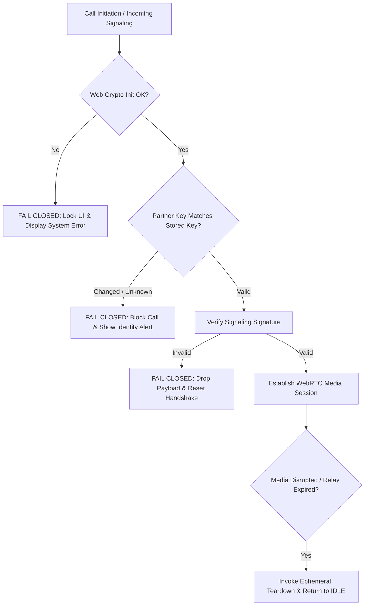

# Security Failure Architecture — Between Us

**Tagline**: Two People. One Private Connection.  
**System Phase**: Phase 02 — Final System & Trust Architecture  
**Status**: Approved Specification  

---

## 1. Security Failure Principles

System failure handling in **Between Us** is strictly governed by the **Fail-Closed Security Principle**:

```
+-----------------------------------------------------------------------------------+
| CORE PRINCIPLE: FAIL CLOSED FOR SECURITY-CRITICAL OPERATIONS                      |
|                                                                                   |
| Whenever a security initialization failure, cryptographic error, credential       |
| expiration, or unverified identity condition occurs, the application MUST FAIL    |
| CLOSED by blocking communication, clearing transient session memory, and         |
| displaying an explicit user error.                                                |
|                                                                                   |
| Downgrading into an unencrypted, unauthenticated, or silently trusted state is    |
| STRICTLY PROHIBITED.                                                              |
+-----------------------------------------------------------------------------------+
```

---

## 2. Failure Mode & Resolution Matrix

| Failure Event | Failure Category | Immediate System Action | Security State | User Interface Impact | Recovery Requirement |
| :--- | :--- | :--- | :--- | :--- | :--- |
| **Signaling Server Unavailable** | Control Plane Outage | Abort call establishment attempt | **Fail Closed** | Display "Signaling Unavailable" banner | Retry when signaling connection recovers |
| **Peer Identity Changed** | Cryptographic / MITM Alert | Reject incoming SDP offer; disconnect session | **Fail Closed** | Display Red Alert: "Partner Identity Changed!" | Force explicit out-of-band SAS re-pairing |
| **Unverified Peer Connection** | Authentication Failure | Block media track rendering; reject ICE handshake | **Fail Closed** | Display "Unverified Peer" overlay | Complete out-of-band SAS fingerprint approval |
| **Invalid / Tampered Signature** | Payload Integrity Failure | Drop signaling WebSocket message; reset handshake | **Fail Closed** | Display "Handshake Error" message | Re-initiate signed handshake |
| **Expired Pairing Code** | Token Expiration | Reject pairing submission | **Fail Closed** | Display "Pairing Code Expired" | Generate fresh pairing code token |
| **Expired TURN Credential** | Credential Expiration | Deny coturn relay allocation | **Fail Closed** | Request updated TURN token from signaling | Automated short-lived HMAC token refresh |
| **TURN VPS Unavailable** | Relay Infrastructure Failure | Attempt direct P2P connection if safe | **Graceful Fallback** | Display "Direct P2P Only" indicator | Fall back to direct P2P socket or report error |
| **Crypto Init Failure** | Web Crypto / OS Failure | Halt application startup completely | **Fail Closed** | Display Locked System Error | Upgrade browser or reset browser origin storage |

---

## 3. Failure State Decision Flows


