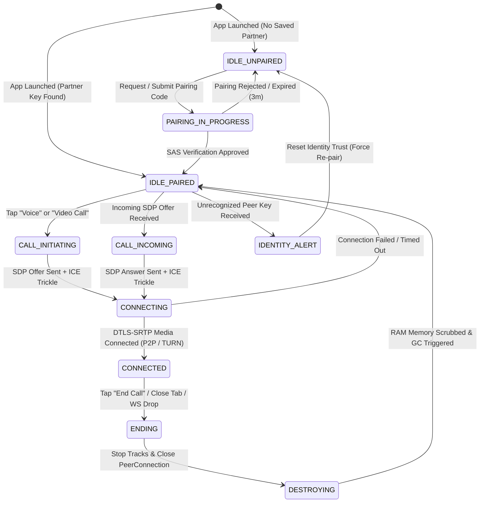

# Session Architecture — Between Us

**Tagline**: Two People. One Private Connection.  
**System Phase**: Phase 02 — Final System & Trust Architecture  
**Status**: Approved Specification  

---

## 1. Persistent Identity vs. Ephemeral Call Session

A foundational design requirement of **Between Us** is the strict separation between long-term **Persistent Identity** and short-lived **Ephemeral Call Sessions**.

```
+-----------------------------------------------------------------------------------+
| PERSISTENT IDENTITY LAYER                                                         |
| - Ed25519 Cryptographic Key Pair                                                  |
| - Stored in browser IndexedDB (extractable: false)                                |
| - Survives browser restarts and system reboots                                    |
| - Used exclusively to sign ephemeral handshake payloads                           |
+-----------------------------------------------------------------------------------+
                                          │
                                          ▼
+-----------------------------------------------------------------------------------+
| EPHEMERAL CALL SESSION LAYER                                                      |
| - Volatile WebRTC Session Keys (DTLS-SRTP Master Keys)                            |
| - Short-lived TURN REST Credentials (HMAC-SHA-1, 15m TTL)                         |
| - Ephemeral WebSocket Connection Tokens & Nonces                                  |
| - Exists purely in volatile RAM during active connection setup and media call     |
| - PURGED IMMEDIATELY upon call disconnect or browser tab close                    |
+-----------------------------------------------------------------------------------+
```

---

## 2. Ephemeral Session Lifecycle State Machine



---

## 3. Ephemeral Credentials & Token Lifetimes

| Token / Secret Type | Derivation Source | Storage Location | Lifetime / TTL | Purge Trigger |
| :--- | :--- | :--- | :--- | :--- |
| **Pairing Code Token** | Signaling PRNG | Signaling RAM / Client RAM | Max 3 minutes | Pairing success, failure limit (3), or timeout |
| **Signaling Socket Token** | Signaling WS Handshake | Client RAM / Server RAM | WebSocket socket duration | Connection drop, call teardown, or 60s idle |
| **TURN REST Credential** | Signaling HMAC-SHA-1 | Client RAM / coturn RAM | Max 15 minutes | Call termination or 15m expiration |
| **DTLS-SRTP Master Key** | WebRTC C++ Core Engine | Browser Volatile RAM | Active media stream duration | `RTCPeerConnection.close()` |
| **Ephemeral Session Nonce** | `crypto.getRandomValues()` | Client RAM / Server RAM | Max 60 seconds | Nonce cache slide or socket disconnect |
